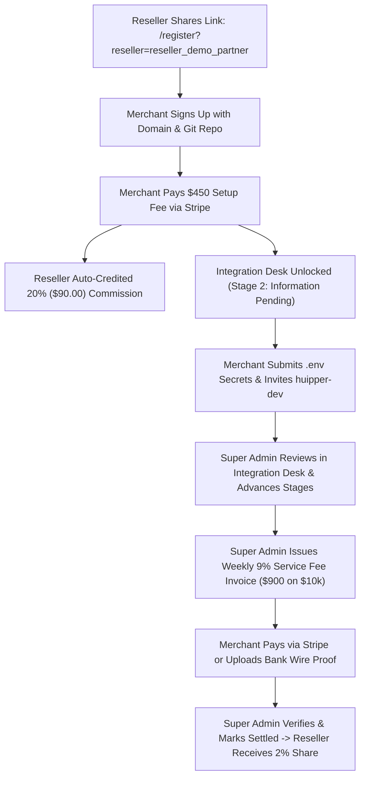

# PGX Gateway — Test Credentials & QA Testing Guide (PRD v1.0)

This document provides all verified login credentials, portal URLs, and end-to-end testing procedures for the **PGX Gateway** platform, adhering 100% to the official PRD specifications.

---

## 🌐 Local Environments & Services

| Service | Local URL / Host | Status | Description |
| :--- | :--- | :--- | :--- |
| **Frontend Web App** | [http://localhost:5173](http://localhost:5173) | 🟢 Active | Vite + React + Tailwind + TypeScript |
| **Backend REST API** | [http://localhost:5000](http://localhost:5000) | 🟢 Active | Node.js + Express + TypeScript + Socket.IO |
| **API Health Check** | [http://localhost:5000/api/v1/health](http://localhost:5000/api/v1/health) | 🟢 Active | JSON Status Response |
| **Database** | MongoDB Atlas Cluster (`pgxdb`) | 🟢 Connected | Multi-tenant replica set with live persistence |

---

## 🔑 Role Credentials Matrix

### 1. 👑 Super Administrator (Platform Owner)
The platform owner manages gateway-wide Stripe keys, white-glove onboarding, integration desks, weekly 9% invoice settlement, and reseller tenant configurations.

- **Login URL:** [http://localhost:5173/super-admin](http://localhost:5173/super-admin)
- **Email:** `superadmin@pgxgateway.com`
- **Password:** `SuperAdminPass2026!`
- **Role:** `super_admin`

#### Key Capabilities to Test:
1. **Platform Settings Tab:**
   - Configure platform-wide Stripe keys (`pk_test_...`, `sk_test_...`, `whsec_...`).
   - Set official GitHub handle (Default: `huipper-dev`).
   - Adjust setup fee with 1-click presets: **$450.00 Standard MVP** or **$565.00 Turnkey VIP**.
2. **White-Glove Integration Desk:**
   - View submitted merchant GitHub repositories, preferred domains, hosting providers, and tech stacks.
   - 1-click copy decrypted merchant `.env` secrets.
   - Advance merchant delivery status across all 7 PRD milestones:
     $$\text{Payment Pending} \rightarrow \text{Information Pending} \rightarrow \text{Under Review} \rightarrow \text{In Development} \rightarrow \text{Integration \& Testing} \rightarrow \text{Completed} \rightarrow \text{Delivered}$$
3. **Live Integration Chat:**
   - Message merchants in real-time with full history persistence.
4. **Weekly Invoicing Desk:**
   - Verify bank wire transfer payment proofs and mark weekly invoices as settled (`settled` / `paid`).

---

### 2. 🤝 Reseller (Pure Affiliate Partner — Zero Stripe Requirement)
Resellers function purely as affiliate growth partners with zero Stripe integration required, eliminating account ban risks.

- **Login URL:** [http://localhost:5173/admin](http://localhost:5173/admin)
- **Email:** `reseller@demo.com`
- **Password:** `ResellerPass2026!`
- **Reseller ID:** `reseller_demo_partner`
- **Unique Referral Link:** [http://localhost:5173/register?reseller=reseller_demo_partner](http://localhost:5173/register?reseller=reseller_demo_partner)

#### Economics & Commissions to Verify:
- **Setup Fee Commission (20%):** Automatically earns **$90.00** when a referred merchant pays the standard $450 setup fee.
- **Weekly Volume Commission (2%):** Earns **$200.00** per $10,000 weekly volume processed by referred merchants.
- **Affiliate Portal View:**
  - View total referred merchants (`merchant.new@demo.com`, `merchant.paid@demo.com`).
  - Track accrued affiliate profit and current prepaid balance ($90.00+).

---

### 3. 🔒 Merchant 1: Unpaid Account (Paywall & Setup Fee Testing)
A registered merchant awaiting initial setup fee payment to test the lock state and Stripe checkout paywall.

- **Login URL:** [http://localhost:5173/login](http://localhost:5173/login)
- **Email:** `merchant.new@demo.com`
- **Password:** `MerchantPass2026!`
- **Current Milestone:** `payment_pending` (Stage 1)
- **Referred By:** `reseller_demo_partner`

#### Flow to Test:
1. Log in and navigate to the **Integration** tab (`/dashboard?tab=integration`).
2. Verify the **$450.00 Setup Fee Paywall** is active and locks the GitHub collaboration desk and `.env` vault.
3. Click **"Pay $450.00 Setup Fee via Stripe"** to initiate the Stripe checkout session.

---

### 4. 🚀 Merchant 2: Paid & Active (Full White-Glove Desk & Invoices Testing)
A paid merchant actively undergoing integration with full access to the white-glove collaboration desk, live chat, and weekly invoicing engine.

- **Login URL:** [http://localhost:5173/login](http://localhost:5173/login)
- **Email:** `merchant.paid@demo.com`
- **Password:** `MerchantPass2026!`
- **Current Milestone:** `in_development` (Stage 4 of 7)
- **Hosting Provider:** `Vercel`
- **Tech Stack:** `Next.js / React`
- **Preferred Domain:** `https://davidbrandstore.com`
- **Git Repo:** `https://github.com/david-merchant/luxury-store.git`

#### Key Capabilities to Test:
1. **White-Glove Integration Desk (`/dashboard?tab=integration`):**
   - Active 7-stage visual milestone stepper highlighting `In Development`.
   - **GitHub Collaborator Card:** 1-click copy `huipper-dev` and mark collaboration invite sent.
   - **PRD Metadata Form:** Update hosting provider, tech stack, and integration notes.
   - **Secure `.env` Credential Vault:** View masked environment secrets, toggle show/hide, edit and save securely.
2. **Live Integration Chat:**
   - Real-time conversation thread between Merchant and Super Admin.
3. **Weekly Invoices Tab (`/dashboard?tab=invoices`):**
   - View issued invoice `INV-2026-WK45-001` ($10,000 volume $\times$ 9% = **$900.00** payable fee).
   - Test **"Pay with Stripe"** online checkout.
   - Test **"Upload Bank Wire Transfer Proof"** modal to submit transfer receipt for manual verification.

---

### 5. ⚙️ Root Administrator (Alternative Admin Console)
- **Login URL:** [http://localhost:5173/admin](http://localhost:5173/admin)
- **Email:** `admin@pgxgateway.com`
- **Password:** `AdminSecurePass2026!`
- **Role:** `admin` / `admin_root`

---

## 🧪 Quick E2E Testing Scenarios

---

## 📡 API Reference Summary

| Method | Endpoint | Description | Access |
| :--- | :--- | :--- | :--- |
| `POST` | `/api/admin/login` | Authenticate Super Admin / Reseller | Public |
| `POST` | `/api/auth/login` | Authenticate Merchant | Public |
| `POST` | `/api/auth/register` | Register Merchant with `resellerId`, `websiteDomain`, `gitRepoUrl` | Public |
| `GET` | `/api/setup/status` | Get merchant integration & setup status | Merchant |
| `POST` | `/api/setup/checkout-session` | Create Stripe checkout session for $450 setup fee | Merchant |
| `POST` | `/api/setup/collab-invite` | Submit GitHub invite, hosting, tech stack & `.env` secrets | Merchant |
| `GET` | `/api/setup/messages` | Fetch integration chat messages | Merchant / Super Admin |
| `POST` | `/api/setup/messages` | Send integration chat message | Merchant / Super Admin |
| `GET` | `/api/setup/admin/merchants` | Get all integration desk merchants with filters | Super Admin |
| `PUT` | `/api/setup/admin/merchant-status` | Update delivery stage milestone | Super Admin |
| `GET` | `/api/invoices` | List weekly invoices | Merchant |
| `POST` | `/api/invoices/:id/proof` | Upload bank wire transfer proof slip | Merchant |
| `POST` | `/api/invoices/generate` | Auto-generate weekly invoice from transaction volume | Super Admin |
| `PUT` | `/api/invoices/:id/status` | Verify payment and mark invoice settled | Super Admin |
