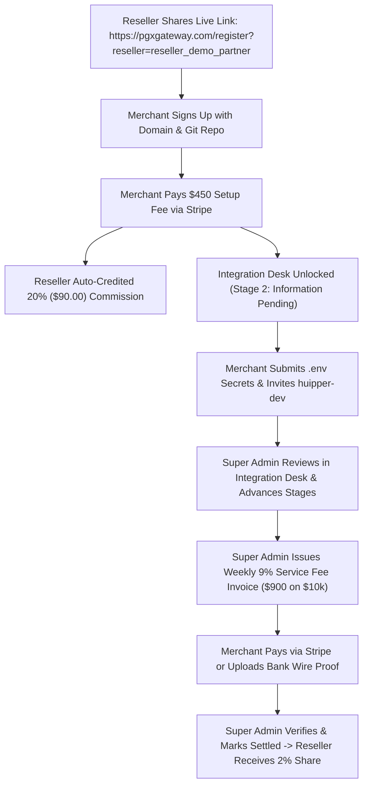

# PGX Gateway — Live Production Credentials & QA Testing Guide (PRD v1.0)

This document provides all verified login credentials and direct links for testing on the **Real Deployed Production Domains**: **`https://pgxgateway.com`** and **`https://api.pgxgateway.com`**, adhering 100% to the official PRD specifications.

---

## 🌐 Live Production Domains & Services

| Service | Live Production URL | HTTP Status | SSL & Cloud Provider |
| :--- | :--- | :--- | :--- |
| **Frontend Web App** | [https://pgxgateway.com](https://pgxgateway.com) | 🟢 200 OK | SSL Active (Nginx / Dokploy) |
| **Backend REST API** | [https://api.pgxgateway.com/api/v1](https://api.pgxgateway.com/api/v1) | 🟢 200 OK | SSL Active (Node.js + Socket.IO) |
| **API Health Check** | [https://api.pgxgateway.com/api/v1/health](https://api.pgxgateway.com/api/v1/health) | 🟢 200 OK | Multi-zone Cloud |
| **Database** | MongoDB Atlas Cluster (`pgxdb`) | 🟢 Connected | Multi-tenant live persistence |

---

## 🔑 Production Role Credentials Matrix

### 1. 👑 Super Administrator (Platform Owner)
The platform owner manages gateway-wide Stripe keys, white-glove onboarding, integration desks, weekly 9% invoice settlement, and reseller tenant configurations.

- **Live URL:** [https://pgxgateway.com/super-admin](https://pgxgateway.com/super-admin)
- **Email:** `superadmin@pgxgateway.com`
- **Password:** `SuperAdminPass2026!`
- **Role:** `super_admin`

#### Key Capabilities to Test on Live Domain:
1. **Platform Settings Tab:**
   - Configure platform-wide Stripe keys (`pk_test_...`, `sk_test_...`, `whsec_...`).
   - Set official GitHub handle (Default: `huipper-dev`).
   - Adjust setup fee with 1-click presets: **$450.00 Standard MVP** or **$565.00 Turnkey VIP**.
2. **White-Glove Integration Desk:**
   - View submitted merchant GitHub repositories, preferred domains, hosting providers, and tech stacks.
   - 1-click copy decrypted merchant `.env` secrets.
   - Advance merchant delivery status across all 7 PRD milestones:
     $$\text{Payment Pending} \rightarrow \text{Information Pending} \rightarrow \text{Under Review} \rightarrow \text{In Development} \rightarrow \text{Integration \& Testing} \rightarrow \text{Completed} \rightarrow \text{Delivered}$$
3. **Live Integration Chat:**
   - Real-time messaging with merchants using WebSockets (`wss://api.pgxgateway.com`).
4. **Weekly Invoicing Desk:**
   - Verify bank wire transfer payment proofs and mark weekly invoices as settled (`settled` / `paid`).

---

### 2. ⚙️ Root Administrator (Alternative Admin Console)
- **Live URL:** [https://pgxgateway.com/admin](https://pgxgateway.com/admin)
- **Email:** `admin@pgxgateway.com`
- **Password:** `AdminSecurePass2026!`
- **Role:** `admin` / `admin_root`

---

## 🔒 Production Clean State Status
- **Demo Reseller (`reseller@demo.com`):** Permanently Suspended & Access Revoked.
- **Demo Merchants (`merchant.new@demo.com`, `merchant.paid@demo.com`):** Permanently Deleted from MongoDB Atlas.
- **Active Real Merchants:** 5 verified live registrations under Primary Root Gateway.

---

## 🧪 Real Production E2E Flow

